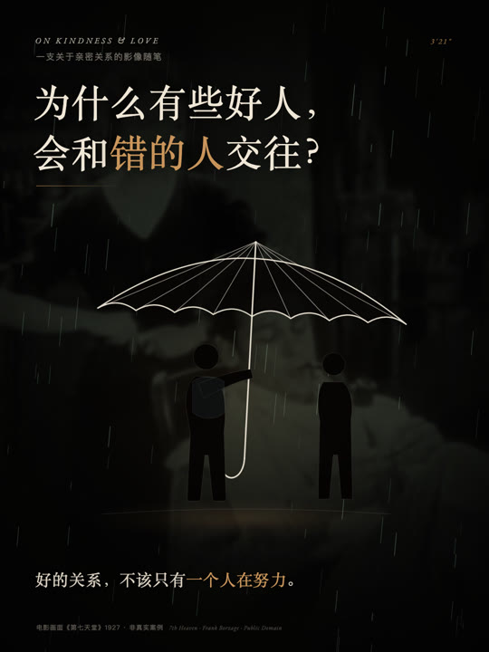

# zhati-relationship-film

一个可复用的 **AI 视频 skill / 工作流**：把客户给的关系主题/文稿，做成 3 分钟电影感影像。**素材不绑定某一部电影**——客户实拍、公版经典电影、授权 stock、照片、纯文字、混合都可以；固定的是 16 拍结构、字体/色板/运动语法、3:4 封面和 QA。

A reusable agent skill for client-customized 3-minute Chinese relationship video essays. The material is swappable: client footage, public-domain classic film, licensed stock, photos, text-only, or a mix. The fixed parts are the 16-beat structure, the type/colour/motion system, the 3:4 cover and the QA gates. Built for [huashu-motion](https://github.com/alchaincyf/huashu-motion) workflows.



> Demo cover from the original episode. The code is MIT; the sample narration/cover text is © the author and not licensed for reuse — replace it with your own script. See [NOTICE.md](NOTICE.md).

## 这是什么

不是“一键生成视频”的应用，而是一套给 AI agent 的 **skill + 模板 + 脚本**：

- **SKILL.md**：9 步生产流水线、硬门、完整工作方式。
- **references/**：客户 brief、素材策略、16 拍结构、视觉系统、逐项文本槽、时间轴重排、版权/伦理、发布文案。
- **templates/**：母版 HTML 合成 + 1080×1440 的 3:4 封面 + Brief/Treatment/来源/素材 manifest 模板。
- **scripts/**：建新工程、素材清单检查、替换 cues、生成 SRT、重排场景时间、渲染、出封面、验收。
- **workflow.md**：一页 checklist。
- **CHANGELOG.md**：版本记录。

## 素材不是固定的

这是 v1.1 最重要的变化：**不要默认每一期都用《第七天堂》/弗洛伊德/亚里士多德/康德。**

| 客户要什么 | 用什么素材 | 怎么处理 |
|---|---|---|
| 真实关系/门店/用户故事 | 客户实拍、照片、产品特写 | 优先；写清授权/肖像；人脸保持真实 |
| 时代感/影史/雨夜 | 公版经典电影（1–3 部） | 去音轨、补帧、逐片 credit |
| 缺具体场景 | 授权 stock | 留 license/订单；不要水印预览 |
| 观点/信/独白 | 纯文字、图形、一个物件 | 让字和留白成为画面 |
| 品牌/机构 | 客户素材 + 一点公版/纹理 | 品牌色只做强调，不做硬广 |
| 混合 | 2–3 种来源 | 一套 grade、一套字、每源 credit |

母版里的电影/肖像只是**参考实现**。客户不需要电影，就不放电影；客户要真实素材，就优先真实素材。完整选择见 [`references/asset-strategy.md`](references/asset-strategy.md)，客户问题清单见 [`references/client-brief.md`](references/client-brief.md)。

默认输出：

| 项 | 默认 |
|---|---|
| 正片 | 1920×1080 / 30fps / 2:40–3:40 |
| 画幅 | 16:9 正片 + 3:4 封面（1080×1440） |
| 语言 | 中文旁白 + 烧录字幕 + `.srt` |
| 声音 | 旁白 + 原创配乐 + 雨声，约 −15 LUFS，真峰值 ≤ −1.5 dBFS |
| 交付 | MP4 / SRT / 封面 PNG+JPG / 发布文案 / 来源记录 / 可编辑工程 |

## 安装

```sh
git clone https://github.com/Alzat007/zhati-relationship-film.git
cd zhati-relationship-film
./install.sh
```

`install.sh` 会把仓库软链到 `~/.agents/skills/zhati-relationship-film`，让支持 skill 的 agent 自动发现它。

## 需要什么

- **huashu-motion**：提供 `om`、Chrome 渲染、studio。仓库不包含 `vendor/`，需要从 huashu-motion 工程复制。
- **ffmpeg / ffprobe**。
- **Chrome / Chromium**（`om` 会调用）。
- 一个 **master 工程**：包含 `vendor/`、一套起始素材（电影/照片/肖像/字体/纹理）和一条占位音轨。仓库只提供模板，不包含这些资产（体积/权利原因）。
- 客户素材或授权 stock（可选；有就优先用）。
- 可选：本地声音克隆（例如 `macos-local-voice` skill）来做本人声线。

## 快速开始

```sh
# 1. 建新一期（--ref 指向你的 master 工程）
~/.agents/skills/zhati-relationship-film/bin/new-episode my-episode \
  --base "$HOME/relationship-films" \
  --ref "$HOME/relationship-films/master"

# 2. 填 Brief 和文稿
cd "$HOME/relationship-films/my-episode"
$EDITOR BRIEF.md 文稿.txt

# 3. 填客户 brief：素材模式、必须用/不能用、权利
# 4. 生成新旁白 + cues.json（这一步不在本仓库内；用你的本地声音管线）
# 5. 把客户素材放进 assets/imported/，填 assets.manifest.json
# 6. 换文案 / 重排时间 / 换音轨
#    读 references/text-slots.md、references/retiming.md、references/asset-strategy.md
#    跑 python3 scripts/asset_report.py --manifest assets.manifest.json --project .

# 7. 检查 + 渲染
om check . --samples 6
om render . --silent --fps 30 --workers 4 --video extract

# 8. 验收 + 3:4 封面
scripts/verify.sh .
scripts/render_cover.sh .
```

第一次没有 master 工程时：

1. 安装 huashu-motion，新建一个空工程。
2. 复制 `templates/index.template.html` 为 `index.html`，`templates/cover-3x4.template.html` 为 `cover/cover.html`。
3. 从 huashu-motion 工程复制 `vendor/`。
4. 按 `references/asset-strategy.md` 和 `references/rights-and-ethics.md` 放入起始素材（公版电影/照片/肖像/字体/纹理）和一条 `assets/score.wav` 占位音轨。
5. 把这个工程作为 `--ref`。新一期再用客户素材替换，不需要永远用同一套片。

## 工作流（一页版）

1. 读客户 brief，锁内容 + 素材模式；填 10 行内容计划。
2. 读 `references/beat-sheet.md`，把主题放进 16 拍。
3. 写 950–1150 字旁白，保留“一种理解角度”“不是对所有人的解释”“责任不能替对方开脱”等限定。
4. 生成新旁白 + `cues.json`。**不要复用模板里的旧旁白。**
5. 建工程，按 `references/text-slots.md` 换掉每一处文案。
6. 按 `references/asset-strategy.md` 换素材：客户实拍/公版/stock/照片/纯文字/混合；填 manifest，跑 `asset_report.py`。
7. 按 `references/retiming.md` 重排场景/视频窗口/字幕。
8. 替换 `assets/score.wav`，生成 SRT。
9. `om check` + `om still` 逐场景检查。
10. `om render`（1080p/30fps 约 25–35 分钟）。
11. 独立冷审，修 MUST-FIX。
12. 3:4 封面 + 发布文案 + `output/` 交付。

完整说明见 [SKILL.md](SKILL.md)，可打印的 checklist 见 [workflow.md](workflow.md)。

## 仓库结构

```
SKILL.md                      agent 主说明 + 9 步流水线
workflow.md                   一页 checklist
README.md                     本文件
CHANGELOG.md                  版本记录
LICENSE                       MIT（代码/脚本/文档）
NOTICE.md                     示例文案、电影、肖像、字体、声音的权利说明
install.sh                    安装为 skill
bin/new-episode               建新一期
docs/demo-cover.jpg           演示封面
examples/cues.example.json    字幕/时间轴输入示例
references/
  client-brief.md             客户问题清单、内容矩阵、确认点
  asset-strategy.md           客户实拍/公版/stock/照片/纯文字/混合、素材槽、manifest
  beat-sheet.md               16 拍结构
  visual-system.md            色板/字体/伞/雨/声音/封面
  text-slots.md               逐项替换清单
  retiming.md                 新旁白的时间轴重排
  rights-and-ethics.md        片源/肖像/声音/伦理
  publishing.md               标题/文案/标签
templates/
  index.template.html         母版 16:9 合成
  cover-3x4.template.html     3:4 封面
  assets.manifest.example.json 素材清单
  episode-brief.template.md
  treatment.template.md
  publish-copy.template.md
  sources.template.md
scripts/
  new_episode.sh
  prepare_media.sh
  replace_cues.py
  cues_to_srt.py
  retime_scene.py
  render.sh
  render_cover.sh
  verify.sh
  asset_report.py
```

## 不包含什么

为了体积和权利清晰，仓库**不包含**：

- 电影片段、肖像、字体、纹理等二进制素材；
- 旁白、配乐、雨声、声音克隆；
- 原成片 MP4、母版工程、`vendor/`；
- 示例视频的完整旁白授权（示例文案仅作结构参考，不可直接复用）。

## 版本

- **v1.1.0**：素材/内容可按客户要求替换；新增 client brief、asset strategy、素材 manifest、asset_report、模板 `data-asset-slot`；脚手架改为“最新模板代码 + master 起始素材”。
- **v1.0.0**：首个公开版本。

## 许可证

- **代码、脚本、模板、文档**：MIT，见 [LICENSE](LICENSE)。
- **示例旁白/标题/封面文字/演示封面**：© 2026 Alzat007，保留所有权利，不在 MIT 范围内；复用前请换成你自己的文案。见 [NOTICE.md](NOTICE.md)。
- **电影**：*7th Heaven* (1927)，美国公版；页面同时把中国列为公版，但欧盟/英国等地区期限不同。片段未随仓库分发；使用前按发布地区复核。
- **肖像**：Freud / Aristotle / Kant 的参考图均为 Wikimedia Commons 公版；未随仓库分发。
- **字体**：未分发；模板使用 macOS 系统字体（Songti SC / PingFang SC）与本地授权 webfont，请勿再分发系统字体。

## 致谢

- 视觉/渲染基础：[huashu-motion](https://github.com/alchaincyf/huashu-motion)（花叔）。
- 参考影片：*7th Heaven* (1927)，Frank Borzage。
- 参考肖像：Max Halberstadt（Freud）、Jastrow（Aristotle bust）、佚名（Kant）。

---

如果这套模板帮到你，欢迎在 Issues 里贴出你做的某一期，或提 PR 改进 16 拍结构、封面和文案模板。
